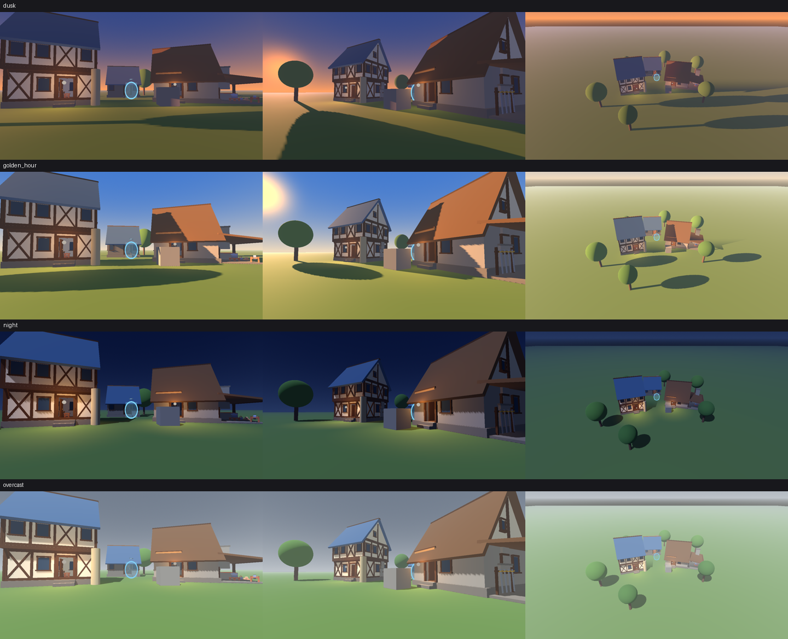
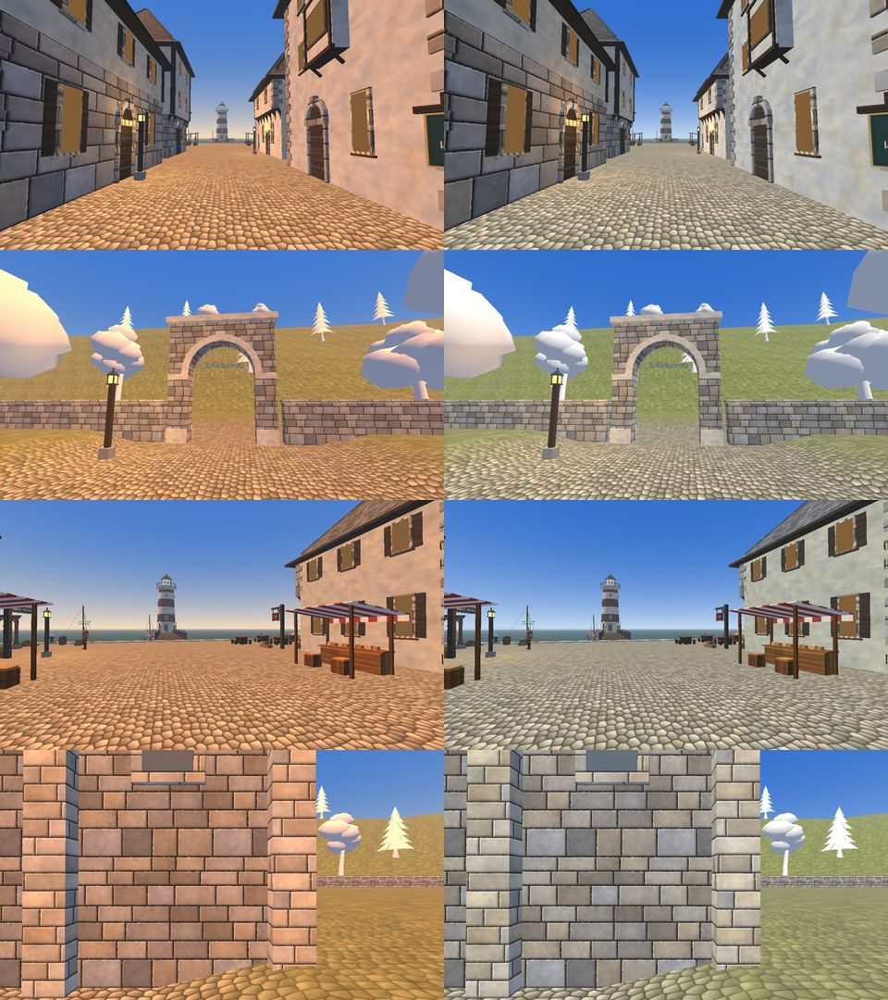
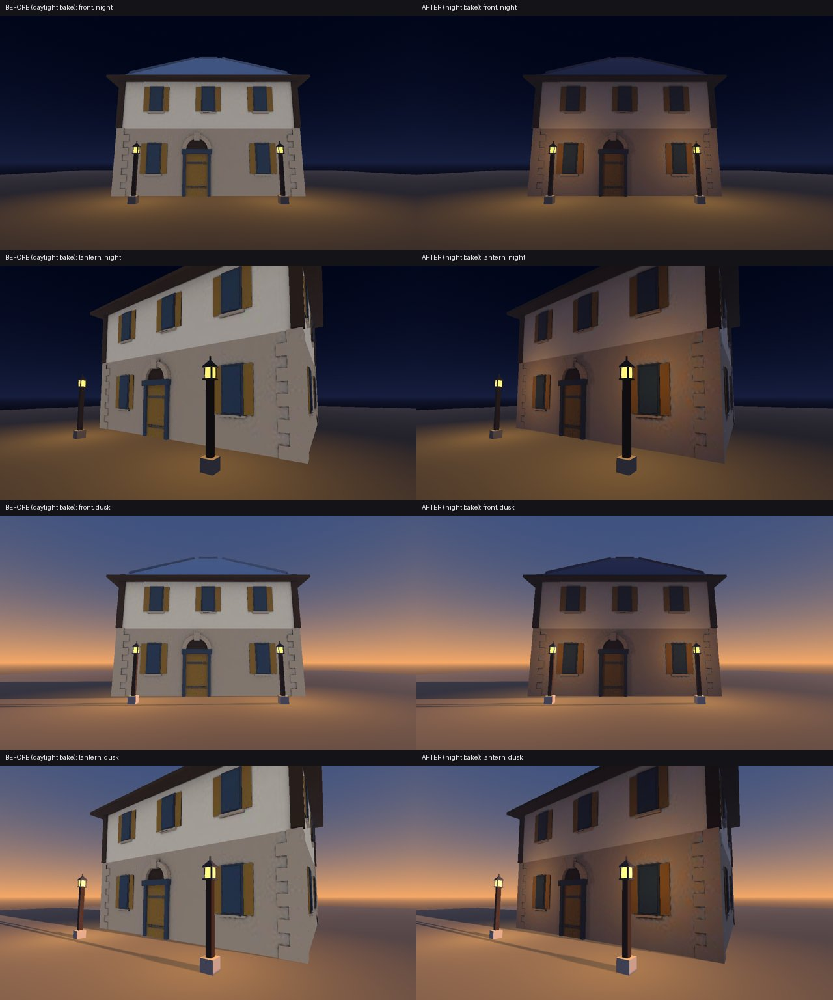

# Lighting and atmosphere presets (tested)

Five `scene.json` `environment` blocks that render well in a world package:
**golden_hour**, **dusk**, **night** and **overcast** hold one hour (the sun does not
move); **day** runs the clock (`day_length_minutes` 360) with a near-white sun, the only
preset for a world whose sun moves (see "A running clock" below). Each one was rendered in the
real browser on a sample world, and the screenshots and numbers are in
[`gallery/`](gallery/). They are style-neutral starting points: any world (iamar
family or a brand-new look) can apply one and then tune the colours to its own
style profile.

| Path | What it is |
|---|---|
| `presets/<id>.json` | One preset: `schema`, `id`, `title`, `description`, `derived_from`, `environment` |
| `lighting.py` | `list`, `check`, `apply`, `bake-args`, `ao-args`, `measure`, `sample`, `render` (below) |
| `night_bake_demo.py` | the before/after night bake pair in `gallery/night_bake/` ("Night: bake the time you show") |
| `gallery/` | `<preset>_<view>.png` (800x450), `sheet.png` (all 12), `numbers.json` |
| `../../tests/style/lighting_test.py` | Tests: presets pass, seeded mistakes fail, apply works, the gallery matches the presets, and (with `IAMAR_PROJECT`) every field is allowed by the browser schema |



## Use one

```
python3 kit/style/lighting/lighting.py list
python3 kit/style/lighting/lighting.py apply dusk worlds/my_world            # replaces scene.json environment
python3 kit/style/lighting/lighting.py apply night worlds/my_world --keep-sky # keep your own cubemap sky
python3 kit/style/lighting/lighting.py check my_preset.json                  # your own variant
```

Then look at it: `iamar-world preview worlds/my_world <out>`, or render every preset
at once on your world with fixed eye-height cameras:

```
python3 kit/style/lighting/lighting.py render worlds/my_world out/lighting \
    --godot <godot or iamar browser exe> --project <browser project folder> \
    [--preset dusk ...] [--view "x,y,z>lx,ly,lz" ...] [--size 1280x720]
```

`render` copies the world to a temp folder (your world is not touched), applies each
preset, runs the browser's `world_view.gd` (the engine behind `iamar-world preview`)
at below-normal priority, and writes `<preset>_<view>.png`, `numbers.json` (draw
calls, primitives, mean / 5th / 95th percentile luminance, % clipped, % crushed,
warmth = mean red - mean blue, contrast) and `sheet.png`. It needs a rendering
display (it is not a headless run); on a Linux server use `offscreen`.

These presets are a world's chosen look; `iamar-world shots` (`../../shots/`, job A1) is
the review loop that shoots a world at day, dusk and night. Its times patch the
environment and remove `sun.direction`, so they review how the world holds up at other
hours. To review a preset itself, use `render` above, which keeps the preset whole
(sun direction included).

## What a package can and cannot set

A package sets only the fields in `docs/WORLD_FORMAT.md` 4.1 that the browser reads
(`scripts/worlds/world_builder.gd` `_environment` and `schemas/scene.schema.json` in
the iamar browser source (not public)): `sky` (procedural / color / cubemap), `time_of_day`,
`day_length_minutes`, `sun`, `ambient`, `fog`, `weather` (reserved) and `exposure`.
`lighting.py check` refuses anything else.

- **No bloom, glow, colour grade or tonemap field exists.** The browser always uses a
  linear tonemap with your `exposure`. The "grade" is carried by colour choices: warm
  sun against a cool ambient and fog, a sky whose horizon matches the sun. Emissive
  surfaces (`emission` + `unlit` primitives, glTF emissive or unlit materials) are how
  lamps and windows glow. Do not invent fields: the validator rejects the world.
- **`fog.sky_affect` (number 0 to 1) is accepted by browsers with the schema fix**
  (an internal task, the iamar browser source (not public) 24028ff, `schemas/scene.schema.json`). Older browsers, including the
  pinned 0bef8c6d, refuse the whole world with it, so `check` accepts it with a warning.
  The presets leave it out, so fog never covers the sky.
- **The sun goes dark outside about 6.2 h to 17.8 h.** With no `sun.direction`,
  the browser places the sun from `time_of_day` and multiplies its energy by
  `clamp(4 x height, 0, 1)`: at 17.4 h it is x0.55, at 18.5 h it is 0. The city's
  own dusk (18.5 h) and night (21.5 h) values therefore give a package no sun at all.
  `dusk` and `night` set `sun.direction` (a sun 8 degrees above the western horizon,
  and a moon from the south-east), which always gets full energy. `check` fails a
  preset whose sun is below the horizon.
- **Warm fog is refused.** A peach fog (`#eccfa8`) tinted the whole city valley
  yellow (MASTERPLAN_TODO B15, FAILED). Keep the warmth in the sun and surfaces and
  the fog cool and light; `check` fails light, saturated fog with a hue of 15-65
  degrees.
- **`weather.kind`** (`cloudy` in `overcast`) is accepted and not drawn in the v0
  browser; the overcast look comes from sky, sun, ambient and fog alone.
- **Shadows:** one orthogonal 50 m shadow pass from the sun (as the city's). Shadows
  roughly double the draws of shadow casters; `sun.shadows: false` saves them.

## The presets and their numbers

Rendered 2026-10-20 on the lighting sample (`lighting.py sample`: the kit starter
meadow, three `iamar-world assets building` houses, primitive trees and two warm
point lights; 22.2k scene triangles), Godot 4.7.2 Compatibility renderer, Intel Arc
140V, the iamar browser source (not public) 3671a8bb, 1280x720. Views: `street` (eye height, 1.7 m, down the
lane), `houses` (eye height, looking across toward the sun side), `above` (22 m up).

| Preset | Sun | Mean luma street / houses / above | Clipped max | Warmth street / above | Draw calls | Primitives (max) |
|---|---|---|---|---|---|---|
| golden_hour | 16.6 h, #ffb064 x1.8 | 0.455 / 0.500 / 0.623 | 0.47% | +0.025 / +0.200 | 171-176 | 38.5k |
| dusk | direction, 8 deg, #ff9458 x1.25 | 0.319 / 0.309 / 0.432 | 0.00% | +0.032 / +0.156 | 171-175 | 38.5k |
| night | moon direction, #b8c8f0 x0.35 | 0.263 / 0.232 / 0.293 | 0.00% | -0.048 / -0.078 | 172-176 | 38.5k |
| overcast | 13 h, #e6eaf0 x0.35 | 0.553 / 0.533 / 0.672 | 0.32% | +0.028 / +0.034 | 172-176 | 38.5k |

No preset crushes blacks (0% of pixels at luma <= 0.02) or clips more than 0.5%.
A preset costs no triangles: the draw calls and primitives are the sample's own and
change only with the shadow casters the sun direction selects (the sample is over
the 150 draw-call low-tier target because each generated building is many surfaces,
not because of lighting). Night stays readable (luma about 0.25, blue) with warm
lamps for contrast; it is a game night, not a photographic one.

What changed while tuning (first pass to final, same cameras; the first pass still had the catalogue trees):

- golden_hour read as plain afternoon (warmth near 0 at eye height): sun warmer and
  stronger (#ffc27a x1.6 to #ffb064 x1.8), ambient cooler and lower (#a8a8bc x0.7 to
  #98a2c4 x0.6). Eye-height warmth 0.012 to 0.025, houses -0.005 to +0.069.
- night was day-for-night bright (luma 0.29 / 0.26 / 0.36, bright green grass):
  ambient #5a6890 x0.6 to #4e5c86 x0.42, moon x0.4 to x0.35, exposure 1.15 to 1.1.
- overcast was milky (luma 0.61-0.71, 3.1% clipped from above): sky top darker,
  ambient x0.95 to x0.8, fog 0.006 to 0.0045, exposure 1.0 to 0.95. Clipping 3.12%
  to 0.02%.
- Catalogue trees (`kit/catalog/assets/trees/*.glb`) rendered white in a package
  (vertex colours ignored: an internal task), so the sample uses primitive trees.

## A running clock: preset `day` (trap: the golden-hour sun at noon)

A sun without `sun.direction` and with `day_length_minutes` above 0 moves: at noon it stands
overhead with the colour and energy you chose for its low hour. Harbour attempts 4 and 5 applied
`golden_hour` and then set `day_length_minutes` 360, so the `#ffb064` x 1.8 sun lit noon: the
grey cobbles (texture mean sRGB 146, 139, 129) rendered orange and the grass yellow in every day
shot (FAILED, review gaps 3360 and 3690; `kit/shots/README.md` "Yellow day grass" has the
arithmetic). The fixed-hour presets are safe only as they are (`day_length_minutes` 0).

- `lighting.py check <preset or world folder>` fails a moving sun whose warmth, energy x (red -
  blue) of its colour, is above 0.40 (golden hour: 1.10; the browser default `#fff4e0` x 1: 0.12),
  warns above 0.25, and warns at an energy above 1.4.
- For a running clock apply `day`: a `#fff3df` sun at 1.1 (the city's midday colour, its energy
  lowered for the package's linear tonemap), cool ambient and haze, starting at 10:30. Warm the
  look with the sky, the surfaces and the lamps. To keep the golden look instead, fix the hour
  with `sun.direction` (the browser then ignores `time_of_day`).
- The shots catch it too: `iamar-world compare-shots <out>/shots --style world/style.json` (one
  folder, no before) fails a day shot whose ground colour lies off the profile's ground colours
  (`kit/lint/README.md`, "Ground colour by day").

Evidence (2026-10-22, zoe, Intel Arc 140V, iamar browser 54321399, tier low, six of the a5
review's cameras at `day`): the harbour a5 world as built against the same world after
`lighting.py apply day`. Ground colour off the harbour profile's ground: 13.3, 13.7, 17.0, 17.2,
11.2, 13.3 before, 0.0 for all six after; `compare-shots before after` passes and the reverse
fails all six.



(Rows: rv_arrival, rv_gate_close, rv_square, rv_edge_north. The white trees are this older
browser's catalogue-tree colours, the same in both columns.)

## Night: bake the time you show

A light bake (`kit/blender/bake_unlit.py`, recipe `bake_sky_sun`) writes one time of day into
unlit textures. A preset or the review's night shots darken the sky and the live-lit things, never
a baked wall: walls baked in daylight glow day-bright under a black night sky (the harbour
blind-test review, sheet_n). So bake the time the world is seen at:

```
# lanterns and their point lights in scene.json first (style-gen lantern, recipe lit_lantern), then per baked object:
python3 kit/style/lighting/lighting.py bake-args night --world worlds/my_world --object tavern
#  --sun=-0.400,0.800,0.450 --sun-color=... --sun-strength 1.100 --sky=... --sky-strength 0.420 --lamp=x,y,z,r,g,b,63.0 ...
iamar-world blender-run kit/blender/bake_unlit.py -- raw/tavern.glb worlds/my_world/assets/tavern.glb 64 --texel 0.03 <those options>
```

`bake-args <preset>` turns any preset into bake options: the sun or moon (towards it, the
preset's colour, energy x pi, since a Cycles sun of strength pi lights white as the browser's
energy 1 does), the ambient colour and energy as the uniform sky; with `--world` and `--object`
also every point light of that world within its range + 12 m (`--reach`) of the object, moved into
the object's own frame (position, yaw, scale) as `bake_unlit.py --lamp x,y,z,r,g,b,watts`
(45 W per unit of `energy`, divided by the scale squared on a scaled object, since its frame shrinks the distances). The lanterns themselves stay live-lit props with emissive glass.

One bake shows one time. A world that sits at dusk bakes dusk; a world reviewed or played at
night bakes the night (`dusk` and `night` are both readable with lanterns: choose by the brief).
A world whose time runs (`day_length_minutes` > 0) cannot be right at every hour with unlit
walls: it still gets baked light, the time-independent kind in the next section.



`gallery/night_bake/` (`night_bake_demo.py`: a style-gen house with two style-gen lanterns,
shot by `iamar-world shots` in the real preview, iamar player build 25 (657acfd3), RTX A5000,
1280x720): **before**, the house baked with bake_unlit's daylight defaults; **after**, baked with
`bake-args night` and the two lanterns. At night the daylight bake's upper wall stays near white
while the night bake's is dim blue-grey, with warm pools on the wall beside each lantern; at
dusk the night bake reads darker than the sky, which is why a bake follows the world's own time.
Rebuild it with `python3 kit/style/lighting/night_bake_demo.py <out> --no-shots` (Blender), then
`--shots-only` (the browser; on a shared host run only that part in the render queue).

## A running clock: bake the sky, not the time

When the world's clock runs (`environment.day_length_minutes` > 0), a time-of-day bake
(`bake_unlit.py`, `bake_vertex_light.py`) is right at one hour only. Do not drop baking: on the
low tier the browser draws no shadows, so an unbaked house floats on its street at every hour
(harbour blind test a5: this README used to say "keep it live-lit", the builder baked nothing,
the review found no contact shadow anywhere on low and a brief whose accepted D3 default said
"baked light"). Bake what does not change with the hour instead: how much sky each vertex sees.

```
# per static model you authored: neighbours from scene.json (in the model's frame), then the bake
python3 kit/style/lighting/lighting.py ao-args --world worlds/my_world --object quay_street
#  --occluder=worlds/my_world/assets/house_a.glb,0.86603,0,0.5,4.2,...  (one per neighbour within 3 m)
iamar-world blender-run kit/blender/bake_vertex_ao.py -- raw/quay_street.glb worlds/my_world/assets/quay_street.glb \
    --distance 1.5 <those options>
iamar-world blender-run kit/blender/bake_vertex_ao.py -- raw/house_a.glb worlds/my_world/assets/house_a.glb \
    --max-edge 2 --floor 0.6 --strength 0.7 --distance 1.5 <ao-args for house_a>
iamar-world audit dark-bake worlds/my_world      # lists them as sky_ao_objects; no clock WARN
```

`bake_vertex_ao.py` (recipe `bake_ao_vertex`) multiplies ambient occlusion into COLOR_0 and keeps
the materials lit, so the live sun, its shadows (medium tier up) and the clock light the model as
before, and the AO adds what holds at every hour: dark under eaves and jetties, in door reveals,
and, with `--occluder`, the band round each house's foot on the street or quay it stands on.
`ao-args` turns the world's other placed `.glb` models within `--reach` (3 m) of the object into
`--occluder` options (path + the 3 x 4 glTF matrix into the object's frame; yaw and scale; models
with `animation` or `sway` are left out). Terrain and primitives are neither baked nor occluders:
a ground that should take the houses' contact darkness is a `.glb` (a street, quay or yard mesh
with vertices every 0.5 m, since AO is only as fine as the mesh). Rebake a model when it or a
neighbour moves. The bake writes `asset.extras.iamar_bake.kind = "sky_ao"`, which
`iamar-world audit dark-bake` reports; on a running clock that audit warns when nothing is baked
and when an unlit time-of-day bake is used. Lanterns stay live-lit props with emissive glass and
their scene.json point lights.

Tested by `kit/tests/blender/sky_ao_bake_test.py` (a ground grid baked with a turned house beside
it: dark only under and beside the house, white elsewhere, lit materials, marker reported).

## Engineering vs style

Applying a preset and the rules above (allowed fields, sun above the horizon, no
invented fields) are engineering and hold for every world. The colours are style:
the iamar profile's city looks are in `../iamar/style.json` `atmosphere.presets`
(reference values, filmic in the city); a custom style profile can carry its own
`atmosphere.presets` and check them with `lighting.py check` after copying one into
a preset file.
